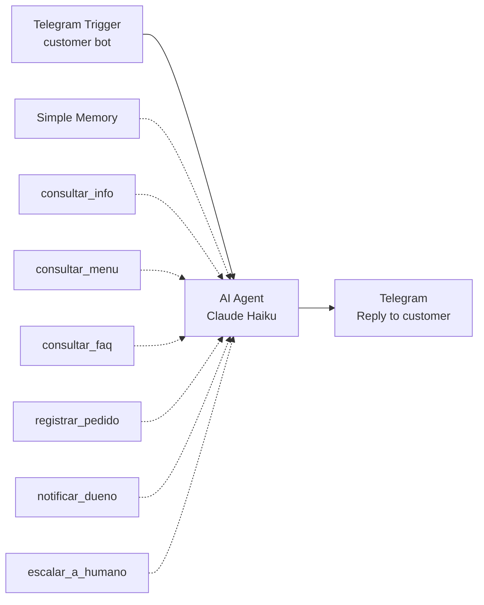

# Brasa Burger Bot 🍔🤖

An AI ordering assistant for a burger restaurant, running on Telegram. It answers questions about the menu, hours and delivery, takes complete orders step by step, saves them to **Google Sheets**, notifies the owner, and hands the conversation to a human when needed. Built with **n8n** and **Claude**.

> 🇪🇸 Resumen en español al final. *Brasa Burger is a fictional restaurant created for this demo.*

## Features

- **Answers from real data.** Menu, prices, hours, delivery fees and FAQs live in a Google Sheet that the owner can edit with no code. The agent always looks them up and never invents prices or products.
- **Takes full orders.** Walks the customer through products and extras, delivery or pickup, name and address, and payment method. It checks the delivery minimum, shows a summary with the total, and only saves the order after explicit confirmation.
- **Knows what's sold out.** Products marked `disponible = no` are never offered, and the bot suggests an alternative.
- **Notifies the owner** instantly through a second Telegram bot, with all the order details.
- **Hands off to a human** for complaints, requests to talk to a person, large event orders, changes to confirmed orders, or questions it can't answer. Before escalating, it asks for a contact phone number.
- **Remembers the conversation** for each customer, using the last 10 messages.
- **Guardrails.** Never promises refunds, discounts or exact response times. Short, plain-text answers with no Markdown.

## How it works

| Component | Type | Purpose |
|---|---|---|
| **AI Agent** | n8n AI Agent | Follows the [system prompt](system-prompt.md) and decides which tool to use. |
| **Anthropic Chat Model** | Claude Haiku | Language model. Cheap and fast for chat. |
| **Simple Memory** | Window buffer, 10 messages | Session key = Telegram chat ID, so each customer has their own memory. |
| **consultar_info / menu / faq** | Google Sheets Tool, *Get rows* | Read the `info`, `menu` and `faq` tabs. |
| **registrar_pedido** | Google Sheets Tool, *Append row* | Saves confirmed orders to the `pedidos` tab. Date and chat ID come from fixed expressions; the rest is filled by the AI with `$fromAI`. |
| **notificar_dueno** | Telegram Tool, second bot | Sends the new order to the owner. |
| **escalar_a_humano** | Telegram Tool, second bot | Alerts the owner with the reason, a summary and the customer's contact. |

## Google Sheet

One spreadsheet with these tabs:

| Tab | Content |
|---|---|
| `info` | Name, address, phone, hours, services, delivery fee, delivery minimum, delivery time, payment methods, tone of voice, welcome message. |
| `menu` | Burgers, combos, sides, drinks and extras, with description, price in COP, and availability (`si`/`no`). |
| `faq` | Frequently asked questions and answers: vegetarian options, delivery area, ingredient changes, event orders, parking. |
| `pedidos` | Orders. Exact headers in [`sheet-template/pedidos.csv`](sheet-template/pedidos.csv). |
| `LEEME` | Instructions for the owner. |

The read tools return every column in the tab, so `info`, `menu` and `faq` can use whatever column names are clearest. Only `pedidos` needs the exact headers, because the order tool writes to them by name.

## Setup

1. **Google Sheet.** Create the tabs above and fill them with your restaurant's data.
2. **Two Telegram bots.** Create them with [@BotFather](https://t.me/BotFather): one for customers, one for owner alerts. The owner must send `/start` to the alerts bot once, because bots can't message users who haven't started them.
3. **Import** [`workflow.json`](workflow.json) in n8n (*Workflows → Import from file*).
4. **Credentials:**
   - Telegram Trigger and *Responder al cliente*: the customer bot.
   - `notificar_dueno` and `escalar_a_humano`: the alerts bot.
   - Anthropic Chat Model: your API key, or n8n's AI credits.
   - All Google Sheets tools: your Google account.
5. **Replace the placeholders:**
   - `YOUR_GOOGLE_SHEET_ID` in the four Sheets tools, or pick your sheet from the list.
   - `YOUR_OWNER_CHAT_ID` in both alert tools. To get it, message the alerts bot and open `https://api.telegram.org/bot<TOKEN>/getUpdates`.
6. **Activate** the workflow and test it in Telegram. Once it's active, check runs in *Executions* and don't use *Test workflow*, because Telegram allows only one webhook per bot.

## Cost

Measured cost: about 5,400 input tokens and 70 output tokens per reply. With Claude Haiku that's roughly **USD 0.0006 per reply**, so 1,000 replies cost under one dollar.

## Lessons learned

- `$('Node name')` reads data from any earlier node. `.first()` is more reliable than `.item` inside AI sub-nodes.
- Clear tool descriptions matter as much as the system prompt: they decide when the agent uses each tool.
- Mixing fixed expressions (date, chat ID, `estado = "nuevo"`) with `$fromAI` fields keeps the saved data consistent.
- Export the workflow `.json` after each phase as a backup.

## Tech stack

`n8n` · `AI Agent` · `Claude (Anthropic)` · `Telegram Bot API` · `Google Sheets`

---

## 🇪🇸 Resumen

Chatbot de pedidos con IA para una hamburguesería (ficticia), en Telegram. Responde sobre menú, horarios y domicilios consultando una hoja de Google que el dueño edita sin código. Toma el pedido completo paso a paso, lo registra solo cuando el cliente confirma y avisa al dueño por un segundo bot. Escala a una persona cuando hay quejas, pedidos grandes o preguntas sin respuesta.

Costo aproximado: USD 0,0006 por respuesta. La demo funciona en Telegram y se puede conectar a WhatsApp con la API oficial.
